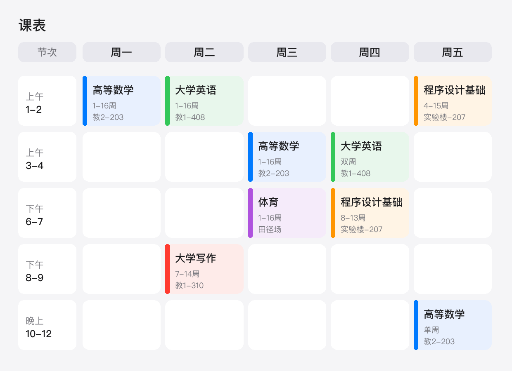
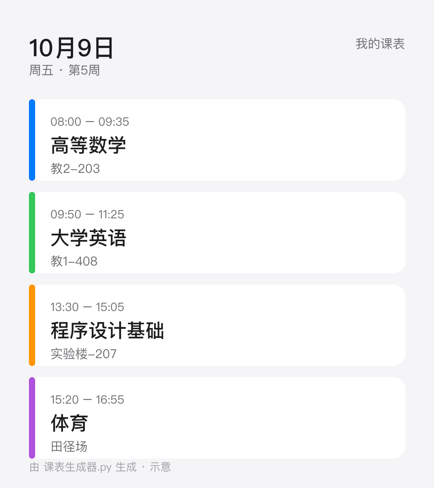

# 📅 课表 → 日历

> 把大学课表一次性展开成标准 `.ics` 文件，iPhone、Mac、Google 日历点一下就能全部导入。
>
> **说白了：不相信任何一键导入工具能把「单双周 + 调休 + 换季作息」算对，所以自己算。**


## 🖼 输入长什么样 → 输出长什么样

你手里拿到的多半是学校发的**周课表网格图**，长这样：



照着它一格一格填进 `COURSES` 就行——课程名、周次、教室，三样都在格子里写着：

```python
("高等数学", 0, "1-2", W.range(1, 16), "教2-203")   # 周一 第1-2节 1~16周
("大学英语", 3, "1-2", W.even(1, 16),  "教1-408")   # 周四 第1-2节 双周
```

生成并导入日历之后：



---

## ✨ 特性

| | |
|---|---|
| 🎯 **逐节展开，不做重复规则** | 每节课都是独立事件，单双周、指定周次、调休停课各算各的 |
| 🌡️ **自动切换作息** | 夏季 / 冬季两套节次时间表，按日期自动选 |
| 🏫 **教室写进位置字段** | 到楼下不用再翻课表 |
| ⏰ **每节课提前提醒** | 默认 20 分钟，`--remind 30` 可改，`--no-alarm` 可关 |
| 📦 **零依赖** | 只用 Python 标准库，`python3 课表生成器.py` 直接跑 |
| 🌏 **标准 iCalendar** | RFC 5545 格式，苹果 / 谷歌 / Outlook / Android 都认 |

---

## 🚀 快速开始

```bash
git clone <这个仓库>
cd timetable-to-ics

# 1. 打开 课表生成器.py，改最上面的「学期设置」和「课程表」
# 2. 生成
python3 课表生成器.py

# 3. 导入
#    iPhone：把 课表.ics 传到手机 → 点开 →「全部添加」
#    Mac：  双击打开，日历 App 会让你选择添加到哪个日历
```

### 可选参数

```bash
python3 课表生成器.py --remind 30        # 提前 30 分钟提醒
python3 课表生成器.py --no-alarm         # 完全不提醒
python3 课表生成器.py --out 我的课表.ics  # 指定输出文件名
```

---

## ⚙️ 怎么改（只需要改这几块）

### 1. 学期设置

```python
START = datetime.date(2026, 9, 7)          # 第 1 周的周一
WEEKS = 17                                  # 一共几周
WINTER_FROM = datetime.date(2026, 10, 1)    # 从这天起换冬季作息
```

### 2. 节假日

```python
HOLIDAY |= _dates(2026, 10, 1, 7)   # 国庆放假，这几天不排课
```

### 3. 作息表

写成「第 N 节课的开始 / 结束，从 0 点算起的分钟数」：

```python
SUMMER = {
    1: (480, 525),    # 8:00 - 8:45
    2: (530, 575),    # 8:50 - 9:35
    ...
}
```

### 4. 课程表

一行一门课：`(课程名, 星期, 节次, 周次, 教室)`

```python
COURSES = [
    ("高等数学", 0, "1-2", W.even(4, 6) | W.range(7, 16), "教2-203"),
    ("大学写作", 0, "6-8", W.range(7, 14),                 "教1-310"),
    ("安全教育", 4, "3-4", {5},                            "报告厅"),
]
```

周次用三个助手写，比数字好读：

| 写法 | 含义 |
|---|---|
| `W.range(1, 16)` | 第 1–16 周 |
| `W.even(4, 12)` | 4–12 周里的双周 |
| `W.odd(3, 11)` | 3–11 周里的单周 |
| `W.step(1, 16, 3)` | 从第 1 周起每 3 周一次：1、4、7、10、13、16 |
| `W.at(1, 5, 9, 14)` | **想上哪几周就写哪几周**，间隔再不规律也行 |
| `A \| B` | 合并两组周次 |
| `{5}` | 只上一次课 |

星期用数字：`0` = 周一 … `6` = 周日。

---

## 🧩 复杂课表怎么写

真实课表经常一堆例外，这里都有对应写法：

| 情况 | 怎么写 |
|---|---|
| 只上前 8 周就结课 | `W.range(1, 8)` |
| 单周上课 | `W.odd(3, 11)` |
| 每隔 3 周上一次 | `W.step(1, 16, 3)` |
| **周次完全不规律** | `W.at(1, 5, 9, 14)` —— 直接把周号列出来 |
| 前半学期 A、后半学期 B（同一时段） | 写两条记录，周次互不重叠就行 |
| 同一门课中途换教室 | 写两条记录，各自带自己的周次和教室 |
| 调休补课（周六补周一的课） | 写在 `EXTRA` 里，直接指定日期 |
| 三节、四节连堂 | 在 `SLOT_PERIODS` 加一条，比如 `"1-4": (1, 4)` |
| 周末有课 | 星期写 `5`（周六）或 `6`（周日） |

**而且它自带冲突检查**：如果哪一天同一时段被排了两门课（通常是周次写重了，或者调休没处理），生成时会直接提醒：

```
⚠️  发现 1 处时间重叠（多半是周次写重了，或调休没处理）：
   2026-12-07   不规律课 ↔ 每三周
```

> 顺带一提：节假日期间自动跳过。比如写 `W.at(1, 5, 9, 14)`，第 5 周正好撞上国庆，那节课就会自动不排。

### ⚠️ 已知边界（先说清楚，免得踩坑）

1. **调休不会自动推算。** 代码只知道「这几天放假」，不知道「学校把周一的课挪到了周六」。**挪课必须自己查校历，在 `EXTRA` 里手写那条记录。** 这是本项目最大的局限，也是最容易漏的一环。
2. **只支持「跳过」，不支持「整体平移」。** 如果学校把整周的课统一推到下一周，要么改 `START` / `WEEKS`，要么一条条写 `EXTRA`。
3. **不处理临时调课。** 老师临时换时间、换教室，生成器不会知道，需要重新改 `COURSES` 再生成一次。
4. **重新导入不会覆盖旧日历。** `.ics` 导入是「新增事件」，同一份课表导入两次就会重复。**重新导入前，先在日历里删掉上一条日历**，再导入新的。

---

## 🧠 为什么不用 RRULE（每周重复）

这是整个项目最重要的设计决定。

课表看着像「每周重复」，实际上**根本不规则**：

- 有的课只上单周或双周
- 有的课只在一段周次里出现
- 国庆、中秋、元旦会把课挪走
- 换季之后，下午和晚上的上课时间**整体提前半小时**

用 RRULE 写，就得堆一长串 `BYWEEKNO` / `EXDATE` / 例外事件。**任何一条写错，某节课就会消失**——而且你只有到那天才会发现。

所以这里选最笨也最可靠的做法：

> **把每一次课都算出来，写成独立事件。**

一个学期下来也就一百多个事件、几十 KB。换来的是「每一节课都保证在对的时间」。

---

## ❓ FAQ

**Q：换学校 / 换学期还能用吗？**
能。改第 1–4 块配置就行，展开逻辑完全通用。

**Q：为什么默认提前 20 分钟提醒？**
从宿舍走到教学楼差不多这个时间。`--remind` 可改成任意分钟。

**Q：Android 能用吗？**
能。`.ics` 是通用格式，Google 日历、手机自带日历都能导入。

**Q：三节连堂怎么写？**
在 `SLOT_PERIODS` 里加一条，比如 `"6-8": (6, 8)`，然后在课程里写 `"6-8"`。

**Q：补课怎么处理？**
在 `COURSES` 里加一条指定周次的记录，周次写成 `{9}` 这样。

**Q：调休能自动算吗？**
不能。代码不知道学校怎么挪的课，**必须自己查校历，在 `EXTRA` 里手写那条补课记录**。详见上面「已知边界」。

**Q：导入了两次，日历里重复一堆怎么办？**
`.ics` 导入是新增，不是覆盖。先在日历 App 里**删掉整个「我的课表」日历**，再重新导入。

---

## 📄 License

MIT。随便用、随便改，能帮你少迟到一节课就好。
